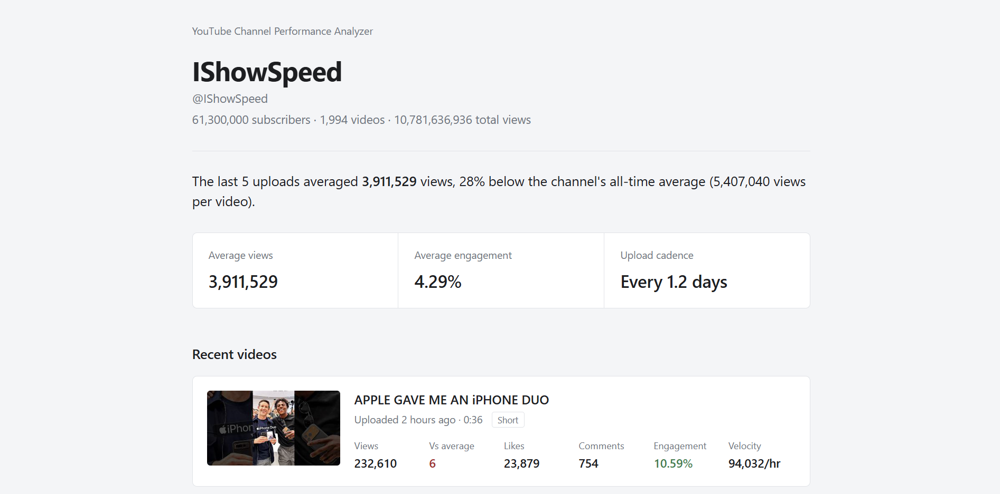

# YouTube Channel Performance Analyzer

A Python command-line tool that takes a YouTube channel handle, pulls the
channel's five most recent videos through the YouTube Data API, calculates
performance metrics the API doesn't provide, and generates an HTML report
that opens in your browser.



## What it does

```
Enter a YouTube handle (example: @mkbhd): @mkbhd
Finding channel...
Fetching latest videos...
Calculating performance...
Generating report...
Report created: report.html
```

The report shows the channel's subscriber count and lifetime totals, a
one-sentence summary of how recent uploads compare to the channel's history,
three headline statistics, and a row for each of the five most recent videos.

## The metrics

The YouTube API returns raw counts. These are calculated from them.

**Engagement rate** — `((likes + comments) / views) × 100`

What percentage of viewers did something beyond watching. A raw like count
means nothing without knowing how many people saw the video.

**View velocity** — `views / hours since upload`

Average views per hour over the video's lifetime. This answers a different
question than "which video has the most views": it shows which recent upload
is gaining views fastest.

**Upload cadence** — average days between uploads

How consistently the channel posts, measured across the five recent uploads.

**Performance index** — `(video views / average views of the 5) × 100`

Each video compared to its own channel's recent average. 100 is exactly
average, 150 means it did 50% better, 60 means it underperformed. A view
count on its own doesn't tell you whether a video did well; this does.

**Trend** — recent average compared to the channel's all-time average

Calculated from the channel's lifetime view count divided by its total video
count. This gives the recent numbers a baseline to sit against.

Videos are also labelled as Shorts (three minutes or shorter) or livestreams,
since both perform differently from regular uploads.

## Setup

You need Python 3.9 or newer.

**1. Clone the repository**

```bash
git clone https://github.com/kaveeshathirimadura/youtube-analyzer.git
cd youtube-analyzer
```

**2. Install the dependencies**

```bash
pip install -r requirements.txt
```

**3. Get a YouTube Data API key**

- Go to the [Google Cloud Console](https://console.cloud.google.com) and
  create a project.
- Enable **YouTube Data API v3** for that project.
- Under **Credentials**, create an API key.
- Restrict the key to YouTube Data API v3 only.

The API is free. This tool uses about 5 quota units per run against a daily
limit of 10,000.

**4. Add your key**

Create a file named `.env` in the project folder:

```
YOUTUBE_API_KEY=your_key_here
```

This file is listed in `.gitignore` and is never committed.

**5. Run it**

```bash
python main.py
```

Enter a handle when prompted. `@mkbhd`, `mkbhd`, and a pasted channel URL all
work.

## Project structure

```
youtube-analyzer/
├── main.py            All application logic
├── style.css          Styles for the generated report
├── requirements.txt   Python dependencies
├── .env               Your API key (not committed)
├── .gitignore
└── README.md
```

`main.py` is organised into sections: input validation, API requests, metric
calculations, formatting helpers, and report generation.

## How it works

The program makes three API requests:

1. **`channels`** — looks up the channel by handle, and returns its statistics
   plus the ID of its uploads playlist.
2. **`playlistItems`** — reads the five most recent video IDs from that
   playlist.
3. **`videos`** — fetches statistics for all five IDs in a single request
   rather than five separate ones.

The results are turned into Python dictionaries, the metrics are calculated,
and the HTML is written to `report.html`.

## Error handling

Any function that fails prints a readable message and returns `None`, and the
caller stops. The program handles a missing or rejected API key, an exhausted
daily quota, connection failures and timeouts, invalid handles, channels with
no public videos, and missing fields in the API response.

No situation produces a stack trace.

## Security notes

- The API key lives in `.env`, which is in `.gitignore`. It is never in the
  source code.
- Error messages are passed through a `redact()` function before printing.
  The `requests` library includes the full request URL in some of its error
  messages, and that URL contains the API key — without this, a network error
  could print the key to the terminal or a log file.
- User input is validated against YouTube's allowed handle characters before
  any request is sent.
- All values taken from the API are HTML-escaped before being written into
  the report, including values used inside HTML attributes.

## Limitations

Worth being clear about what these numbers do and don't tell you.

**View velocity favours new videos.** It averages views across a video's whole
lifetime, so a two-year-old video with millions of views shows a low figure.
It measures lifetime average rate, not current momentum.

**The lifetime baseline is rough.** A channel that has run for ten years and
changed format twice has an all-time average that may not represent anything
current. Channels that post Shorts have their lifetime average inflated by
them.

**Shorts detection is inferred, not exact.** The API has no field marking a
video as a Short, so the program treats anything three minutes or shorter as
one. A genuinely short regular video will be labelled incorrectly.

**Five videos is a small sample.** Upload cadence in particular can be thrown
off by a single break in the schedule.

**Some metrics aren't publicly available.** Watch time, average view duration,
audience retention, click-through rate, and subscribers gained per video live
in the YouTube *Analytics* API, which requires OAuth authorisation from the
channel owner. They cannot be retrieved with an API key. Dislikes were removed
from the public API in 2021.

## Built with

- **Python** — API requests, calculations, error handling
- **YouTube Data API v3** — data source
- **requests** — HTTP requests
- **python-dotenv** — loading the API key from `.env`
- **HTML / CSS** — the generated report

## Possible additions

- Sorting the video rows by views, engagement, or velocity
- Excluding Shorts from the averages
- Saving results to CSV to track a channel over time
