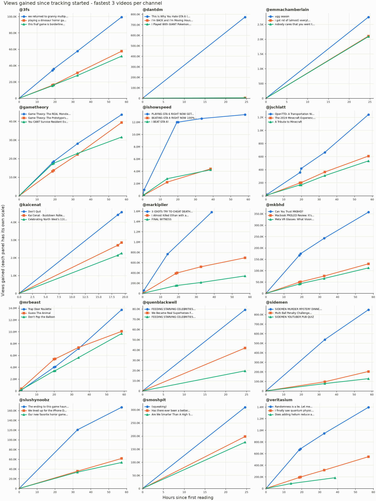

# YouTube Channel Performance Analyzer

A Python data pipeline that tracks YouTube channels over time. Every day it
collects the 50 most recent videos from each channel on a watchlist through
the YouTube Data API, stores every reading in a SQLite database with a
timestamp, and then analyzes the history with pandas and matplotlib.

The point of storing history: the YouTube API can tell you a video has
4.2 million views, but not whether it is still growing. Comparing two
readings taken a day apart can — "this video gained 18,000 views in the last
24 hours" is a different and more useful answer than a single total.



*Views gained since tracking started for the three fastest-growing videos on
each channel. Every line starts at zero when tracking began, so the steepness
of a line is how fast that video is growing. Each panel has its own scale.*

## What it does

The project is three scripts, each with one job:

| Script | Job | Talks to YouTube? |
|---|---|---|
| `main.py` | **Collects.** Fetches channel and video data, calculates metrics, saves a snapshot of every video to `history.db`, and can build an HTML report for one channel. | Yes |
| `analyze.py` | **Analyzes.** Reads the database with pandas and prints comparison tables. | No |
| `charts.py` | **Visualizes.** Draws the growth chart above from the same data. | No |

Collection and analysis are kept separate on purpose. Collection runs
unattended every day; analysis only ever *reads* the database, so nothing
done while exploring the data can damage the history.

## The dataset so far

As of November 22, 2026:

- **2,952 readings** of **753 videos** across **15 channels**
- Collected daily since November 20, 2026; the database keeps the most
  recent 29 days
- **740 videos** have been read more than once, tracked for a median of
  57 hours

The database itself stays on the machine that collects it and is not
published in this repository — see [Data retention and YouTube API
policies](#data-retention-and-youtube-api-policies).

## An early finding: the overall number can point the wrong way

Across all channels together, videos of 3 minutes or less get slightly more
views than longer videos (median 1.97M vs 1.83M). But inside **6 of the 8
channels with at least 5 of each**, the longer videos get more views. On
Veritasium, for example, the median longer video has 7.8M views and the
median video of 3 minutes or less has 1.9M.

The overall result is pulled up by MrBeast, who posts 36 videos of 3 minutes
or less at around 144M views each. Combining every channel into one table
mostly measures *which channels post short videos*, not how short videos
perform. This is known as
**Simpson's paradox**, and it is why `analyze.py` always shows a
per-channel breakdown alongside the overall one.

*Based on a few days of data — this section will be updated as the dataset
grows.*

## The metrics

The YouTube API returns raw counts. These are calculated from them.

Three of them — engagement rate, performance index and trend — are
**switched off by default** in `settings.py` (see [Data retention and
YouTube API policies](#data-retention-and-youtube-api-policies)). Their code
is kept, and they are listed here so it's clear what they measure.

**Engagement rate** *(off by default)* — `((likes + comments) / views) × 100`

What percentage of viewers did something beyond watching. A raw like count
means nothing without knowing how many people saw the video.

**View velocity** — `views / hours since upload`

Average views per hour over the video's whole lifetime. Useful for comparing
recent uploads, but an old video always looks slow.

**Momentum** — `views gained / hours between two readings`

How fast a video is gaining views *right now*. This is what the database
makes possible: it compares the current reading with an earlier one instead
of averaging over the video's whole life.

**Performance index** *(off by default)* — each video's views compared to the channel's recent
average, shown as `+43%` or `-38%`

A view count on its own doesn't tell you whether a video did well for *that*
channel. This does.

**Upload cadence** — average days between uploads

**Trend** *(off by default)* — the recent average compared to the channel's all-time average
(lifetime views divided by total videos)

For analysis, videos are grouped by length (3 minutes or less, or longer)
using the duration YouTube reports, and livestreams are grouped separately
using YouTube's own livestream field. The project doesn't label videos as
"Shorts": the API has no field for that, and YouTube's policies don't allow
inferring a video's type.

## Setup

You need Python 3.11 or newer.

**1. Clone the repository**

```bash
git clone https://github.com/kaveeshathirimadura/youtube-analyzer.git
cd youtube-analyzer
```

**2. Install the dependencies**

```bash
pip install -r requirements.txt
```

The database is not included in the repository, so `analyze.py` and
`charts.py` need some collected data first — follow the remaining steps,
then run `python main.py --all`.

**3. Get a YouTube Data API key**

- Go to the [Google Cloud Console](https://console.cloud.google.com) and
  create a project.
- Enable **YouTube Data API v3** for that project.
- Under **Credentials**, create an API key.
- Restrict the key to YouTube Data API v3 only.

The API is free. Collecting one channel costs about 3 quota units against a
daily limit of 10,000, so tracking dozens of channels is well within it.

**4. Add your key**

Create a file named `.env` in the project folder:

```
YOUTUBE_API_KEY=your_key_here
```

This file is listed in `.gitignore` and is never committed.

## Usage

**Collecting data**

```
python main.py                      prompt for a handle, then open its report
python main.py "@mkbhd"             analyze one channel and open its report
python main.py --add "@mkbhd"       start tracking a channel
python main.py --remove "@mkbhd"    stop tracking (past readings are kept)
python main.py --list               show the watchlist and how much is collected
python main.py --all                collect every tracked channel, no report
python main.py --help
```

`@mkbhd`, `mkbhd`, and a pasted channel URL all work. On Windows PowerShell,
put quotes around handles that start with `@` — PowerShell treats a bare `@`
as special and silently drops the argument.

**Analyzing data**

```
python analyze.py                   print the comparison tables
python charts.py                    save growth_chart.png and open it
```

**Collecting automatically**

`--all` never stops to ask for input, so a scheduler can run it unattended.
On Windows, this registers a daily run with Task Scheduler (PowerShell):

```powershell
$folder = "C:\path\to\youtube-analyzer"
$action = New-ScheduledTaskAction -Execute "cmd.exe" `
    -Argument "/c .venv\Scripts\python.exe -X utf8 main.py --all >> collect.log 2>&1" `
    -WorkingDirectory $folder
$triggers = @(
    (New-ScheduledTaskTrigger -Daily -At 8:00PM),
    (New-ScheduledTaskTrigger -AtLogOn -User $env:USERNAME)
)
$settings = New-ScheduledTaskSettingsSet -StartWhenAvailable -WakeToRun `
    -AllowStartIfOnBatteries -DontStopIfGoingOnBatteries
Register-ScheduledTask -TaskName "YouTube Analyzer Daily" `
    -Action $action -Trigger $triggers -Settings $settings
```

`-WorkingDirectory` matters: the database path is relative, and without it
Task Scheduler would start in `C:\Windows\System32` and write to a new, empty
database there. Each run's output is added to `collect.log`.

The second trigger and the extra settings are for laptops. A laptop that is
asleep, off, or on battery at 8 PM would otherwise skip that day's run, and
missed days can't be collected afterwards. Running at sign-in as well means a
day is only missed if the computer isn't used at all. Extra runs are
harmless: every reading is timestamped, and momentum divides by the actual
hours between readings.

## How it works

**Collection** takes three chained API requests per channel — no single
endpoint returns a channel's recent videos with their statistics:

1. **`channels`** — looks up the channel by handle and returns its statistics
   plus the ID of its uploads playlist.
2. **`playlistItems`** — reads the 50 most recent video IDs from that
   playlist, following `nextPageToken` when more than one page is needed.
3. **`videos`** — fetches statistics for those IDs, in chunks of 50 (the
   API's limit per request). The API does not return videos in the order
   requested, so the results are put back into playlist order.

**Storage** is a SQLite database with three tables:

```
channels    one row per channel, refreshed each run
watchlist   which channels --all collects
snapshots   one row per video per run — never edited, deleted after 29 days
```

Rows in `snapshots` are only ever added or deleted, never edited: a reading
records what YouTube reported at that moment, so changing it would falsify
the history. Readings older than 29 days are deleted automatically (see
below). All queries use `?` placeholders rather than building SQL from
strings.

**Analysis** in `analyze.py` makes a few deliberate choices:

- **One row per video.** A video read on five different days appears five
  times in `snapshots`. Before comparing groups, only each video's latest
  reading is kept, so no video is counted more than once.
- **Medians, not averages.** One viral video can drag an average far away
  from what a typical video does; it barely moves the median.
- **Small groups are hidden.** Any group with fewer than 5 videos is left out
  of the tables, and the output says how many were hidden.
- **Per-channel breakdowns.** Every format comparison is also shown inside
  each channel (see the finding above).
- **Age shown alongside momentum.** New videos gain views much faster than
  old ones, so each momentum figure is shown with the median age of the
  videos behind it.

`charts.py` imports its calculations from `analyze.py` instead of copying
them, so the tables and the chart can never disagree.

## Project structure

```
youtube-analyzer/
├── main.py            Collection: API requests, metrics, database, HTML report
├── analyze.py         Analysis: pandas comparison tables
├── charts.py          Visualization: the growth chart
├── settings.py        Shared settings: which metrics are switched on
├── style.css          Styles for the HTML report
├── sort.js            Sort buttons for the HTML report
├── history.db         The collected data (SQLite) — local only, not committed
├── growth_chart.png   Output of charts.py
├── requirements.txt   Python dependencies
├── .env               Your API key (not committed)
├── .gitignore
└── README.md
```

## Error handling

Any function that fails prints a readable message saying what went wrong and
what to do about it, then returns `None`, and the caller stops. The program
handles a missing or rejected API key, an exhausted daily quota, connection
failures and timeouts, invalid handles, channels with no public videos,
missing fields in the API response, and a missing or empty database.

No situation produces a stack trace.

## Data retention and YouTube API policies

This project collects data with an API key, without any channel owner
signing in. YouTube's Developer Policies call that *Non-Authorized Data* and
say statistics collected this way must not be stored for more than 30 days
(section III.E.4.b).

So the database keeps a **rolling 29-day window**:

- Every time `main.py` runs, `delete_expired_data()` first deletes readings
  (and channel rows) older than 29 days. 29 rather than 30 leaves a day of
  margin, so a late or missed daily run can't push a reading over the limit.
- After deleting, it runs SQLite's `VACUUM`. A plain `DELETE` only marks the
  space as free and leaves the old bytes in the file; `VACUUM` rebuilds the
  file so deleted data is really gone.
- `history.db` is not committed to this repository, so the raw data is never
  published.

**Some calculated metrics are switched off.** Section III.E.4.h of the same
policies restricts creating new or derived metrics from API data — its own
example is calculating a percentage from like counts, which is what the
engagement rate does. YouTube offers an analytics amendment that permits
such metrics, through an application process.

Until that permission exists, one setting in `settings.py`,
`ADVANCED_METRICS = False`, switches off what the policies restrict:
engagement rate, performance index, trend, ranking channels against each
other, and tables that pool several channels together (section III.E.2
doesn't allow combining data from different content owners). With the switch
off, real data is analyzed one channel at a time. The code is kept, so approval would mean changing that one
line. View counts, averages, upload cadence, velocity, momentum and the
growth chart stay on: they are simple arithmetic on YouTube's numbers, the
kind YouTube's compliance guide lists as acceptable. The report labels
averages, upload cadence, velocity and momentum as calculated by this
project, not by YouTube, and shows when its data was collected.

This is a personal learning project and is not deployed as a public service.

## Security notes

- The API key lives in `.env`, which is in `.gitignore`. It is never in the
  source code.
- Error messages are passed through a `redact()` function before printing.
  The `requests` library includes the full request URL in some of its error
  messages, and that URL contains the API key — without this, a network error
  could print the key to the terminal or to `collect.log`.
- User input is validated against YouTube's allowed handle characters before
  any request is sent.
- All values taken from the API are HTML-escaped before being written into
  the report, including values used inside HTML attributes.

## Limitations

Worth being clear about what these numbers do and don't tell you.

**The channels are hand-picked, not a random sample.** Findings describe
these 15 channels, not YouTube as a whole.

**History is capped at 29 days.** To follow YouTube's data policy, no
reading is kept longer than 29 days, so long-term trends (months or years)
can't be studied with this design.

**Momentum is an average between readings.** It shows the average rate
between two readings, not what happened hour by hour in between.

**Some tracked channels are dormant.** A few channels' most recent uploads
are years old, so their momentum is close to zero. That is accurate, but it
lowers any figure that combines all channels.

**View velocity favours new videos.** It averages views across a video's
whole lifetime, so an old video always shows a low figure. Momentum exists
to answer the "how is it doing now" question instead.

**The lifetime baseline is rough.** A channel that has run for ten years and
changed format twice has an all-time average that may not represent anything
current. Channels that post many short videos have their lifetime average
pulled toward those videos.

**Length is not the same as format.** The API doesn't say whether a video
is a YouTube Short, so the analysis compares videos by length instead. A
3-minute-or-less group contains Shorts and short regular videos alike.

**Some metrics aren't publicly available.** Watch time, average view
duration, audience retention, click-through rate, and subscribers gained per
video live in the YouTube *Analytics* API, which requires OAuth authorisation
from the channel owner. They cannot be retrieved with an API key. Dislikes
were removed from the public API in 2021.

## Built with

- **Python** — the whole pipeline
- **YouTube Data API v3** — data source
- **SQLite** (`sqlite3`) — storing the reading history
- **pandas** — analysis
- **matplotlib** — charts
- **requests** — HTTP requests
- **python-dotenv** — loading the API key from `.env`
- **HTML / CSS** — the single-channel report

## What's next

- A written summary of findings once there are a few weeks of data
- Sorting buttons on the HTML report
- Longer term: a web app where anyone can add the channels they care about
  and see how they are performing over time, without using the command line
